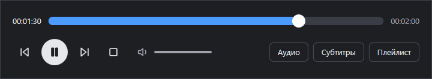

# Kadr

Лёгкий видеоплеер для Windows в духе BSPlayer: видео, панель управления и плейлист —
три отдельных окна без рамок, которые можно расставить как удобно, в том числе на разные мониторы.
Воспроизведение — движок [mpv](https://mpv.io) (libmpv): все форматы и кодеки уже внутри,
ставить K-Lite и прочие кодеки не нужно.

## Скачать и запустить

1. Откройте [последний выпуск](../../releases/latest) и скачайте архив `Kadr-…-win-x64.zip`.
2. Распакуйте его в любую папку (например, `D:\Programs\Kadr`) и запустите `Kadr.exe`.
3. Если Windows попросит установить **.NET Desktop Runtime 10** — установите его
   ([страница загрузки](https://dotnet.microsoft.com/download/dotnet/10.0), пункт «.NET Desktop Runtime», x64).

При первом запуске Kadr сам добавит себя в меню «Открыть с помощью» для видеофайлов
(только для текущего пользователя, без прав администратора). Чтобы видео всегда открывались в Kadr:
правый щелчок по файлу → «Открыть с помощью» → «Выбрать другое приложение» → Kadr → «Всегда».
Убрать Kadr из этого меню: `Kadr.exe --unregister`.

## Что умеет

- Открыл один файл — в плейлисте вся его папка, по алфавиту «как в проводнике» (серия 2 раньше серии 10);
  по окончании файла — следующий.
- Толстая полоса перемотки, в которую легко попасть мышью.
- Размер окна видео — колёсиком мыши (пропорции сохраняются), двойной щелчок — полный экран.
- Звуковые дорожки и субтитры: встроенные и из файлов рядом с видео, русские `.srt` в любой кодировке.
- Продолжение с места остановки, запоминание громкости и положения окон.
- Несколько плееров одновременно; «поверх всех окон»; скриншот кадра с субтитрами.
- Горячие клавиши работают и в русской раскладке — полный список в файле
  [`Горячие клавиши.txt`](Kadr/Горячие%20клавиши.txt) (он же лежит рядом с `Kadr.exe`).

## Сборка из исходников

Нужны .NET 10 SDK и `libmpv-2.dll` (в репозитории его нет — файл больше 100 МБ):

1. Скачайте архив `mpv-dev-x86_64-…7z` (не `v3`) со страницы
   [shinchiro/mpv-winbuild-cmake](https://github.com/shinchiro/mpv-winbuild-cmake/releases)
   и положите из него `libmpv-2.dll` в папку `lib` рядом с `Kadr.slnx`.
2. `dotnet build` — отладочная сборка в `Kadr\bin\Debug\net10.0-windows`.
3. `dotnet publish Kadr -c Release -o publish\Kadr` — готовая папка с программой.

Значок рисует скрипт `tools\make-icon.ps1`.

## Лицензия

Kadr распространяется по лицензии **GNU GPL v3** — см. файл [LICENSE](LICENSE).
Архив с программой содержит libmpv (mpv и FFmpeg) — свободные программы под лицензиями GPL/LGPL;
откуда взяты и где их исходный код — в файле [NOTICE.txt](NOTICE.txt).
